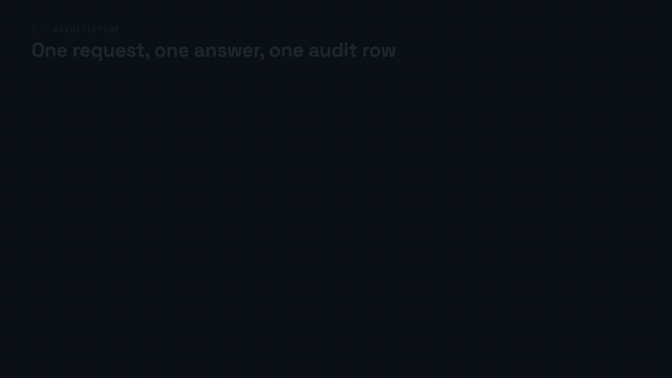

# Fraud Decision Engine

A real-time fraud decision API for online purchases. Each purchase gets `allow`, `review` or
`deny` in a few milliseconds, from live features (Redis, Postgres), hard rules, an XGBoost
model and cost-based thresholds. Every decision is audited, and the service is monitored and
alerted on. An end-to-end machine-learning engineering project.

[](https://github.com/abbylxw/fraud-decision-engine/releases/download/demo-video-v1/fraud_engine_demo.mp4)

**[Watch the 2-minute demo video](https://github.com/abbylxw/fraud-decision-engine/releases/download/demo-video-v1/fraud_engine_demo.mp4)**
(silent, with captions): architecture, the bot attack and the key feature, then serving,
monitoring and an alert firing on the live stack. New to fraud or ML?
[docs/summary.md](docs/summary.md) explains the project on one page.

## Results

Test period: the last 3½ months (Aug 30 – Dec 16), never used for training or tuning, scored once.

| | |
|---|---|
| Purchases / frauds | 30,223 / 1,389, worth $51,395 |
| Ranking quality (PR-AUC) | **0.139** [0.123, 0.157]; random guessing scores 0.046 |
| Sent to review | 2,028 purchases (6.7%), catching **469 frauds** worth $17,326; 23% of reviews are fraud |
| Declined by the model | none; declines come only from the hard rules (a review is always cheaper here) |
| Total cost* | **$44,209**, against $51,395 with no model |
| Latency at 200 requests/s | p50 7 ms, p99 under 20 ms (local Docker, warm) |
| Monitoring | 29 alerts, unit-tested in CI, with a runbook; alert chain proven by a drill |

\* Fraud that gets through + $10 per wrongly declined customer + $5 per review, with a review
assumed to stop the fraud. The saving holds for a review up to about $5 that stops at least
80% of what it sees ([sensitivity](docs/feature_ablation.md)).

## The data

The public Fraud_Data set: one purchase per customer, Jan 1 – Dec 16, 2015.

| | |
|---|---|
| Purchases | 151,112 |
| Devices / countries | 137,956 / 182 |
| Frauds | 14,151 (9.4%) |
| … of which one bot attack in January | 7,600, every one within a second of sign-up |
| Fraud rate outside that attack | 4.6% (about 1 in 22) |
| Typical purchase / average fraud | $35 / $37 |

Split by time: train Jan – Aug 5, validation Aug 5 – 30, test Aug 30 – Dec 16. Bootstrap 95%
confidence intervals on every metric.

## Key findings

1. **One feature mattered more than the algorithm.** Random forest, XGBoost, LightGBM and
   CatBoost tie, on one split and over seven rolling months. Adding one feature, how many
   *other* accounts have ever used this device (`did_other_uid_all`), lifted all four from
   about 0.09 to about 0.14 PR-AUC (paired difference +0.049 [+0.040, +0.059]).
   → [feature_ablation.md](docs/feature_ablation.md), [model_candidates.md](docs/model_candidates.md)
2. **The decision, not the score, is what saves money.** The fraud the model finds is about
   23% precise. Declining pays only above 21% ($10 / ($10 + $37)), so declines would barely
   pay; a $5 review pays above 13.5%. Hence three outcomes, and both thresholds are chosen by
   cost on validation data. → [feature_ablation.md §6–7](docs/feature_ablation.md)
3. **Inputs that are right offline can be wrong live.** Nobody in the dataset buys twice, so
   some inputs meant something else for returning customers. Found by hand-made requests, a
   drift alert and an audit of every input; the model keeps 30 inputs with no loss in accuracy.
   Sex and age added nothing and are not used. → [feature_audit.md](docs/feature_audit.md),
   [model_card.md](docs/model_card.md)
4. **Training and serving compute the same features, and a test proves it.** Counters use the
   purchase's own timestamp; a parity test runs real rows through both code paths and compares
   every value. `--ship` reloads the saved model the way the API does before replacing it.
5. **Without live labels, watch behaviour.** Whether a decision was right is only known weeks
   later, so the engine monitors action rates (allow / review / deny) and drift of the score
   and inputs, on top of the four golden signals. → [monitoring.md](docs/monitoring.md)

## Architecture

```
POST /api/transactions  (Idempotency-Key: a retry gets the stored answer)
        │
        ▼
 [Features]    ←── Redis sliding-window counters + Postgres lookups (IP → country, device
        │            history), computed at the purchase's own time
        ▼
 [Hard rules]  ←── sign-up under 60 s, 2+ accounts on a device in 1 h, impossible age,
        │            sanctioned country → deny; the model never runs
        ▼
 [Model]       ←── XGBoost on 30 inputs, monotone in "other accounts on this device"
        ▼
 [Decision]    ←── score ≥ review threshold → review (thresholds in model_meta.json)
        ▼
 Postgres audit row (decision, rule, score, model version) + Redis counter update
        ▼
 { transaction_id, fraud_decision, response_time }
```

FastAPI (8 workers) · PostgreSQL 16 · Redis 7 · Prometheus + Alertmanager · Grafana · Docker Compose.
Details: [docs/system_architecture.md](docs/system_architecture.md).

## Run it

```bash
cp .env.example .env
docker compose up --build           # first start loads ~5M IP→country rows (~30 s)
curl http://localhost:8000/health   # {"status": "ok", "db": "ok", "redis": "ok"}
```

Local, without Docker (needs Postgres and Redis on localhost):

```bash
python3.13 -m venv .venv && source .venv/bin/activate
pip install --upgrade pip && pip install --group dev   # groups: api, train, dev (pyproject.toml)
uvicorn app.main:app --reload --port 8000
```

A request:

```bash
curl -X POST http://localhost:8000/api/transactions \
  -H "Content-Type: application/json" -H "Idempotency-Key: test-001" \
  -d '{"user_id": "user_123", "signup_time": "2024-01-01T00:00:00Z",
       "purchase_time": "2025-03-14T12:00:00Z", "purchase_value": 250.00,
       "device_id": "device_abc", "source": "SEO", "browser": "Chrome",
       "sex": "M", "age": 30, "ip_address": 3663237372}'
# {"transaction_id": "550e8400-...", "fraud_decision": "allow", "response_time": "..."}
```

| `fraud_decision` | Meaning for the caller |
|---|---|
| `allow` | Approve the order. |
| `review` | Do not auto-approve: step-up check (3-D Secure, SMS code) or a person. |
| `deny` | Decline: a hard rule fired (or, if a future model allows it, a score where declining pays). |

The demo and the alert drill run against the live stack:

```bash
python scripts/demo.py          # eight stories with the decision and its reason, then a replay
python scripts/alert_drill.py   # bot burst → alert pending → firing → Alertmanager (~6 min)
```

Grafana: http://localhost:3000 · Prometheus: http://localhost:9090 · Alertmanager: http://localhost:9093.
An existing database volume from an older version needs `app/data/db_init/008` and `009` applied by hand.

## Monitoring and alerting

| Layer | What is watched |
|---|---|
| **Four golden signals** | Latency (p50, p99, per step) · traffic against its 1-day average · errors (5xx, 422, 409) · saturation (worker CPU, event-loop lag, Postgres pool, Redis memory) |
| **Dependencies** | Postgres and Redis probes, features falling back to Postgres, failed counter updates |
| **Action rates** | Allow / review / deny shares against the 1-day normal and the training-time expectation; share per rule |
| **Drift** | PSI of the score and eight inputs against buckets saved at training time; model version |

29 alerts, each with a severity, a minimum-traffic guard and a runbook section in
[docs/monitoring.md](docs/monitoring.md); unit-tested with `promtool` in CI (19 scenarios).
Live accuracy is not monitored because live traffic has no labels; it is measured offline at
every retrain. No notification channel is configured in the repository (a webhook is a secret).

## Model

```bash
python -m training.evaluate        # candidates with bootstrap CIs and charts → results/
python -m training.train           # retrain and report
python -m training.train --ship    # also replace the served model, if both ship gates pass
```

| Test period (fraud rate 4.6%) | PR-AUC [95% CI] | ROC-AUC |
|---|---|---|
| Random guessing | 0.046 | 0.50 |
| Logistic regression | 0.096 [0.087, 0.108] | 0.63 |
| Random forest (depth 16, 200 trees) | 0.138 [0.123, 0.156] | 0.64 |
| LightGBM (7 leaves, 344 trees) | 0.145 [0.127, 0.163] | 0.64 |
| CatBoost (depth 4, 90 trees) | 0.136 [0.121, 0.154] | 0.64 |
| **XGBoost, served** (depth 3, 140 trees, 30 inputs, refit on train + validation) | **0.139 [0.123, 0.157]** | 0.64 |

The tree models tie (every interval contains every other estimate); XGBoost stays served
unless a challenger beats its interval. How it is trained:

- **The January bot attack is a rule, not a feature.** All 7,600 purchases under 60 s from
  sign-up are fraud (the fastest real customer took 137 s), so `signup_burst` denies them and
  those rows are left out of training. The calendar month is not an input.
- **Tree counts are chosen with scikit-learn's average precision on validation.** XGBoost's
  and CatBoost's built-in PR-AUC overrate a one-tree model and stopped training at tree 1
  ([why](docs/model_candidates.md)).
- **IP country is grouped**: the 10 largest countries, `Unknown`, and continents for the rest,
  one-hot encoded by one function shared with the API (`country_group()`).
- **Two thresholds by cost** (missed fraud = purchase value, false decline $10, review $5),
  chosen on validation; among policies within 1% of the cheapest, the least intrusive wins
  (`training/policy.py`). For this model no score makes a decline cheaper than a review.
- **Ship gate:** a new model replaces the served one only if its test PR-AUC is at least the
  served model's lower confidence bound **and** its policy costs no more.
- **Audit:** every row records `model_version`, `model_score` (NULL when a hard rule decided)
  and `decision_rule`.

### Why these numbers look lower than other Fraud_Data projects

Public notebooks report precision ≈ 0.98, recall ≈ 0.54, ROC-AUC ≈ 0.77 with a **random**
split. Rerunning that recipe (`python -m training.random_split_baseline`):

| Same random forest, same features | Precision | Recall | ROC-AUC |
|---|---|---|---|
| Random 80/20 split, all test fraud | 0.99 | 0.54 | 0.77 |
| … bot rows only | | **1.00** | |
| … all other fraud | | **0.002** | 0.50 |
| Time split (train Jan–Jun, test Jul–Aug) | 0.00 | 0.00 | 0.50 |

A random split leaks the January bot's device ids into training; recall 0.54 is just the
bot's share of fraud. Here the bot goes to rules (100% of bot rows, 0 legitimate rows hit),
and the model is scored on the remaining 4.6% by time: PR-AUC 0.139, three times random.

### Do velocity features work with repeat customers?

Fraud_Data has one purchase per customer, so per-customer counters are always 0.
`python -m training.compare_datasets` runs the same velocity replay on Sparkov (simulated card
data, 1.85M purchases, 999 cards):

| Dataset (test period) | Fraud rate | Static features | + Velocity |
|---|---|---|---|
| Fraud_Data | 4.6% | PR-AUC 0.050 [0.045, 0.055] | 0.134 [0.122, 0.148] |
| Sparkov | 0.36% | PR-AUC 0.878 [0.864, 0.891] | **0.974 [0.967, 0.980]** |

On Sparkov, velocity halves the alert rate (0.94% → 0.43%) while catching more fraud, cutting
cost 27%. Caveats: Sparkov is simulated, it has no devices or IPs (proxies documented in
`training/datasets/`), and label-history features are excluded because production learns
labels weeks late. Spend-spike features were tested too and added nothing. Full numbers:
[docs/evaluation/multi_dataset.json](docs/evaluation/multi_dataset.json).

## Engineering decisions

- **Async throughout:** asyncpg and `redis.asyncio`; model inference runs in a thread pool so
  it never blocks the event loop.
- **Sliding-window counters** in Redis sorted sets, all commands for a request in one pipeline
  (one round trip), pruned at 90 days, updated after the audit row is committed.
- **Atomic idempotency:** the key is claimed with `SET NX` before processing; a duplicate in
  flight gets `409` + `Retry-After`, a later one the stored answer; tested with real concurrency.
- **Read-through fallback:** if Redis has no history (cold start, eviction), counts are rebuilt
  from Postgres and the request still succeeds; the fallback rate is a metric with an alert.
- **Tracked background tasks:** counter updates are referenced, failures counted, and
  shutdown waits for them.
- **Hard rules before the model**, so clear cases never pay for inference.
- **8 workers with bounded connection pools** (88 Postgres connections, under the default 100).
  A missing index once capped throughput at ~50 req/s; the fix and the measurements are in
  [docs/performance_2026-11.md](docs/performance_2026-11.md).

Every decision with the alternatives considered: [docs/design_tradeoffs_and_todos.md](docs/design_tradeoffs_and_todos.md).

## Load testing

```bash
python app/data/client_mimic.py --rps 200 --duration 60 --seed 1   # rate mode: how much load?
python app/data/client_mimic.py --speedup 1000 --duration 3600     # replay mode: realistic traffic
```

Rate mode sends Poisson arrivals at a fixed rate; replay mode sends rows in time order on a
fast-forwarded clock, with returning customers and optional retries after a decline
(`--retry-declined N`). Latest: 200 requests/s, p50 7 ms, p95 11 ms, p99 15 ms, no errors.
After a day idle, the first 30 seconds are slower while caches warm up.
Method and history: [docs/performance_investigation.md](docs/performance_investigation.md).

## Running tests

```bash
pytest tests/ -v                 # 290 tests; data-dependent ones skip without the CSVs
ruff check .
# the alert rules have their own unit tests (19 scenarios), run with promtool:
docker run --rm -v "$PWD/prometheus:/p:ro" --entrypoint promtool \
    prom/prometheus:v2.51.0 test rules /p/tests/alerts_test.yml
```

CI runs all three, then builds the Docker image.

## Documentation

| Page | The question it answers |
|---|---|
| [docs/summary.md](docs/summary.md) | The whole project on one page, for a reader without a machine-learning background |
| [docs/model_card.md](docs/model_card.md) | What is the model, how good is it and for whom, and what must it not be used for? |
| [docs/feature_ablation.md](docs/feature_ablation.md) | How was the main feature found, measured and priced, and why did the better model need a `review` decision? |
| [docs/feature_audit.md](docs/feature_audit.md) | Which inputs meant something else on real traffic, and what was removed? |
| [docs/model_candidates.md](docs/model_candidates.md) | Random forest vs XGBoost vs LightGBM vs CatBoost: how they differ and why they tie here |
| [docs/monitoring.md](docs/monitoring.md) | What is measured, what alerts, and what to check first when one fires (the runbook) |
| [docs/production_readiness.md](docs/production_readiness.md) | What is done, what is partial, what is out of scope |
| [docs/design_tradeoffs_and_todos.md](docs/design_tradeoffs_and_todos.md) | Every design decision with the alternatives rejected, in order |
| [docs/system_architecture.md](docs/system_architecture.md) | Request flow, data models, tables |
| [docs/performance_2026-11.md](docs/performance_2026-11.md), [docs/performance_investigation.md](docs/performance_investigation.md) | Load tests, bottlenecks found and fixed |
| [docs/transaction_failures_and_idempotency.md](docs/transaction_failures_and_idempotency.md) | What happens when a request fails halfway or is sent twice |
| `docs/demo/tour.html` | A one-page interactive tour (open in a browser) |
| [docs/demo/video/](docs/demo/video/) | How the 2-minute demo video is built, and how to rebuild it |

## Project structure

```
app/
  main.py              # FastAPI app: endpoint, idempotency, request metrics, /health, /metrics
  config.py            # settings (REDIS_HOST, DATABASE_URL, ...)
  monitoring.py        # drift arithmetic: buckets and PSI (pure functions, shared with training)
  telemetry.py         # error, dependency, saturation and drift metrics; the 10 s probe
  data/
    data_models.py     # Pydantic models: Transaction → Features → DBWrite; DecisionResponse
    orm_models.py      # SQLAlchemy ORM: TransactionRecord (the audit table)
    client_mimic.py    # load-test client
    db_init/           # SQL init scripts 001-009 (auto-run by postgres on first start)
  decisions/
    rules.py           # hard rules, the allow / review / deny score rule, shadow rules
    models.py          # loads model.joblib + model_meta.json; score(features)
    features/          # request.py (pure), db.py (Postgres), velocity.py (Redis windows)
    model.joblib, model_features.json, model_meta.json   # the served model and its metadata
training/
  build_features.py    # offline feature replay (event time); shares encodings with the API
  train.py             # retrain, pick thresholds by cost, ship gates (--ship)
  policy.py            # cost of an allow / review / deny policy; threshold search
  candidates.py        # the four tree candidates: fitting and tree-count selection
  tune.py              # validation-only hyper-parameter sweep
  evaluate.py          # model comparison with bootstrap CIs and charts
  rolling_eval.py      # rolling-origin evaluation (train on the past, score the next month)
  feature_ablation.py  # does a feature group help? paired bootstrap on the rolling folds
  model_card_slices.py # performance by group, and the model without sex and age
  rule_backtest.py     # what each rule adds on top of the model
  compare_datasets.py  # velocity ablation across Fraud_Data and Sparkov
  datasets/            # Kaggle download + per-dataset loaders (training/eval only)
scripts/
  demo.py              # eight labelled requests against the running stack, then a replay
  alert_drill.py       # bot burst -> alert pending -> firing -> Alertmanager
  export_demo_data.py  # builds docs/demo/tour.html from the evaluation outputs
prometheus/            # alert and recording rules, and their promtool unit tests
alertmanager/          # routing and inhibition (no notification channel configured)
grafana/               # dashboard "Fraud Engine" and datasource provisioning
tests/                 # 290 tests: rules, features, parity, idempotency, policy, monitoring,
                       # the served model file, API
docs/                  # see "Documentation" above
```

## License

[MIT](LICENSE). The Fraud_Data and Sparkov datasets are not part of this repository and have
their own terms.
