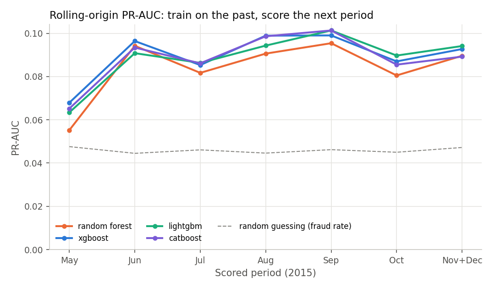

# Model candidates: Random Forest vs XGBoost vs LightGBM vs CatBoost

The served model is chosen among four tree ensembles. This page explains how they differ,
how each was tuned, and what the comparison showed on this dataset. Short version: on
Fraud_Data, once the January bot rows are handled by a rule, **all four land inside each
other's confidence intervals**. The choice between them is about engineering cost, not
accuracy.

## 1. Two families: bagging and boosting

All four build many decision trees and add up their votes. The difference is *how the trees
are built*.

**Random Forest (bagging).** Grow a few hundred *deep* trees, each on a random sample of rows
and a random subset of columns, all independently, then average them. Each tree alone
overfits; averaging many different overfit trees cancels most of the noise. Properties that
follow from this:

- Trees do not depend on each other, so training parallelises trivially and there is no
  "number of rounds" to tune: more trees never hurt, they only cost time.
- No learning rate, no early stopping. The knobs are tree depth and minimum leaf size.
- Robust and hard to misuse. The ceiling is lower than boosting's on datasets with a lot of
  learnable structure, because every tree is trying to solve the whole problem from scratch.

**Gradient boosting (XGBoost, LightGBM, CatBoost).** Grow *shallow* trees one after another,
each one fitted to the mistakes (the gradient of the loss) left by the trees before it, and
add each new tree scaled down by a learning rate. Properties:

- Sequential, so each tree is cheap but they cannot be built in parallel; libraries
  parallelise *inside* a tree instead.
- Needs a learning rate, a number of rounds, and early stopping on a validation set: keep
  adding trees until validation stops improving, then stop. Too many rounds overfits.
- Higher ceiling when there is signal to find; faster to overfit when there is not. On this
  dataset depth 7 trees overfit within three rounds, which is why every booster here is
  depth 3 or `num_leaves` 7.

Things worth looking up if these are new: *bias-variance trade-off* (why averaging helps
bagging), *gradient descent in function space* (what "fit the residuals" means formally),
and *early stopping*.

## 2. What separates the three boosters

They implement the same idea and in most tabular benchmarks finish within a point of each
other. The differences are in how trees are grown, how categorical columns are handled, and
what the defaults protect you from.

| | XGBoost | LightGBM | CatBoost |
|---|---|---|---|
| Tree growth | Level-wise (fills a whole depth before going deeper); `max_depth` is the knob | Leaf-wise (always splits the leaf with the biggest gain); `num_leaves` is the knob, trees are lopsided | Symmetric / oblivious (every node at a depth uses the *same* split); `depth` is the knob |
| Split finding | Exact or histogram | Histogram bins only, plus gradient-based row sampling | Histogram bins |
| Categorical columns | Must be encoded by you (one-hot, ordinal) or `enable_categorical` | Native, by grouping category values | Native and the main selling point: *ordered target statistics* (encode a category by the target mean of earlier rows only, so the encoding cannot leak the row's own label) |
| Overfitting defences | Second-order gradients, L1/L2 penalties, `min_child_weight` | Same ideas; leaf-wise growth overfits small data faster, so `min_child_samples` matters more | *Ordered boosting* (each tree's residuals come from models that never saw that row) plus strong default regularisation |
| Training speed | Baseline | Fastest, especially above ~1M rows | Slowest per tree on CPU (ordered boosting costs extra) |
| Prediction speed | Fast | Fast | Fastest: symmetric trees evaluate as a few bit operations |
| Typical reason to pick it | Default choice, most documentation, widest deployment support | Big data or many features where training time dominates | Many high-cardinality categoricals, small or noisy data, you want good results with little tuning |

**Why leaf-wise vs level-wise matters here.** With weak signal, leaf-wise growth happily
spends its splits on one noisy corner of the data. That is why LightGBM's `num_leaves` is 7
(a depth-3 level-wise tree has 8 leaves) and `min_child_samples` is 50.

**Why CatBoost's headline feature is not exercised here.** All 41 served features are already
numeric: the country column is one-hot encoded in the feature pipeline shared by training and
the API, and `sex`, `source`, `browser` are small integer codes. CatBoost's ordered target
statistics only help when it is handed raw high-cardinality strings (a `device_id` with
137k values would be the natural case), and that would require changing the serving feature
pipeline too. So on this comparison CatBoost competes as "a third booster with symmetric
trees", not on its categorical handling.

## 3. How each was tuned

`python -m training.tune` fits a small grid per algorithm on the training rows (first 70% by
time, bot rows removed) and scores PR-AUC on the validation rows (next 10%). Test rows are
not touched. The grids:

| Algorithm | Grid | Configs |
|---|---|---|
| Random forest | `max_depth` {8, 12, 16} × `min_samples_leaf` {20, 50, 100} | 9 |
| XGBoost | `max_depth` {2, 3, 5} × `learning_rate` {0.03, 0.05, 0.1} × `min_child_weight` {1, 50, 100} | 27 |
| LightGBM | `num_leaves` {7, 15, 31} × `learning_rate` {0.03, 0.05} × `min_child_samples` {20, 50, 100} | 18 |
| CatBoost | `depth` {3, 4, 6} × `learning_rate` {0.03, 0.05} × `l2_leaf_reg` {3, 10} | 12 |

Every booster gets `scale_pos_weight` = negatives / positives (about 21) and a 1000-tree
budget, with the tree count chosen on validation PR-AUC. The chosen settings are written into
`training/train.py` (`make_candidates`) and `training/evaluate.py` (`make_models`) by hand,
with the sweep folder named in the comment, so the served hyper-parameters are always visible
in code rather than hidden in a results file.

Two library-specific traps the sweep hit, kept here because they are easy to fall into:

- **LightGBM's early-stopping callback watches every metric** in the model's metric list,
  and the default list includes log-loss. With `scale_pos_weight` = 21 the log-loss on
  validation gets worse from the first tree, so training stopped at tree 1 with PR-AUC 0.065.
  Fix: `metric="average_precision"` on the model and `first_metric_only=True` on the callback.
- **XGBoost's built-in `aucpr` has the same problem as CatBoost's metric below**, found
  later by the rolling-origin run (section 6). Both boosters now pick their tree count with
  scikit-learn's metric.
- **CatBoost's built-in `PRAUC` is not scikit-learn's average precision.** After one tree it
  reported 0.108 where scikit-learn computes 0.076 (different interpolation; with many tied
  scores the trapezoid rule over-credits), so its overfitting detector also stopped at tree
  1. `use_weights=false` did not change that. Fix: CatBoost trains its full budget and
  `training/candidates.py` picks the tree count with scikit-learn's metric on validation
  every 10 trees, then shrinks the model. Same effect as early stopping with unlimited
  patience; a few seconds slower.

## 4. Results

Run of 2026-11-10 (`python -m training.train`; the report is copied to
`docs/evaluation/train_candidates.json`, since `results/` is gitignored). Each candidate is
fit on train, early-stopped on validation, and the train-only fit is scored on the test period (Aug 30 to Dec 16, 30,223
rows, 4.6% fraud) once. The last row is the previously served XGBoost for reference.

| Candidate | Trees | Validation PR-AUC | Test PR-AUC [95% CI] | Test ROC-AUC |
|---|---|---|---|---|
| Random forest (depth 16, leaf ≥ 20) | 200 | 0.095 | 0.085 [0.076, 0.098] | 0.558 |
| XGBoost (depth 3, lr 0.03, min_child_weight 100) | 368 | 0.112 | 0.091 [0.081, 0.105] | 0.560 |
| LightGBM (15 leaves, lr 0.05, min_child_samples 20) | 190 | **0.115** | 0.091 [0.081, 0.106] | 0.561 |
| CatBoost (depth 4, lr 0.05, l2 10) | 240 | 0.108 | **0.096** [0.084, 0.111] | 0.561 |
| Previously served XGBoost (depth 3, lr 0.05, mcw 50) | 203 | 0.108 | 0.092 [0.081, 0.107] | 0.557 |
| Random guessing | | 0.045 | 0.046 | 0.500 |

How to read it:

- **Every confidence interval contains every other candidate's point estimate.** The spread
  between the best and worst booster on test (0.005) is a third of one CI's width. Nothing
  here distinguishes the three boosters; the random forest sits about 0.006 lower, also
  inside the noise.
- **Validation and test disagree on the order.** LightGBM wins validation and is middle of
  the pack on test; CatBoost is third on validation and first on test. That is what a tie
  looks like with 1,389 test frauds: the ranking reshuffles from sample to sample.
- **The top features are the same for all four**: `did_uid_90d`, `did_txn_cnt_30d`,
  `did_uid_30d` (how many users and transactions this device has had). The algorithms differ
  in how they combine the remaining weak features, and those add almost nothing.
- **Fit time** on 98k rows, Apple M-series laptop: random forest 1.5 s, XGBoost 1 s, LightGBM
  1 s, CatBoost 4 to 6 s (ordered boosting is the extra work). None of it matters at this
  scale; it would at 50M rows, where LightGBM's histogram and sampling tricks pay off.

**Outcome:** the selection rule in section 5 kept XGBoost. LightGBM won validation but its
test PR-AUC (0.091) is well inside XGBoost's interval (upper 0.105). The retrained XGBoost
with the sweep settings scores 0.092 on test, the same as the model it would replace, and
its cost-tuned threshold denies 1.4% of test traffic catching 116 of 1,389 frauds against
1.2% and 106 before: same total cost to within 0.2%.

## 5. Selection rule and what ships

`training/train.py` keeps XGBoost as the incumbent: it is the only booster the API image
installs, and `model.joblib` must unpickle inside the container. A challenger replaces it only
if it wins on validation **and** its test PR-AUC is above XGBoost's 95% confidence interval
upper bound. A win inside the noise band would add a runtime dependency for nothing. The rule
and its outcome are recorded in `model_meta.json` under `selection_rule`.

One honesty note: this rule reads test scores for all four candidates, where the previous
script scored test once. The test set therefore influences which model ships, slightly. It
was accepted because the alternative (switching the serving stack on a validation-only win of
0.002) is the worse mistake, and the test-period numbers reported for the shipped model are
still from a single scoring of that model.

## 6. Rolling-origin check: is the ranking stable over time?

Sections 4 and 5 rest on one validation month and one test period, and the two disagreed on
the order of the boosters. A **rolling-origin evaluation** (also called walk-forward
validation) asks the same question several times: train on the past, score the next period,
move the cut-off (the "origin") forward a month, repeat. `python -m training.rolling_eval`
does this seven times (run of 2026-11-15, results in `docs/evaluation/rolling_origin.json`).

| Fold | Train (bot rows removed) | Tree count picked on | Scored period | Scored frauds |
|---|---|---|---|---|
| 1 | Jan–Mar (21k rows) | Apr | May | 921 |
| 2 | Jan–Apr | May | Jun | 842 |
| 3 | Jan–May | Jun | Jul | 900 |
| 4 | Jan–Jun | Jul | Aug | 833 |
| 5 | Jan–Jul | Aug | Sep | 663 |
| 6 | Jan–Aug | Sep | Oct | 442 |
| 7 | Jan–Sep (128k rows) | Oct | Nov + Dec | 251 |

The boosters choose their tree count on the month *before* the scored one, so the scored
period is never seen while fitting. Hyper-parameters are the tuned ones from section 3, the
same in every fold.

PR-AUC per scored period (fraud rate 4.5 to 4.8% throughout; best in each row in bold):

| Scored | Random forest | XGBoost | LightGBM | CatBoost |
|---|---|---|---|---|
| May | 0.055 | **0.068** | 0.063 | 0.065 |
| Jun | 0.094 | **0.096** | 0.091 | 0.093 |
| Jul | 0.082 | 0.085 | **0.086** | 0.086 |
| Aug | 0.091 | **0.099** | 0.094 | 0.099 |
| Sep | 0.095 | 0.099 | **0.101** | 0.101 |
| Oct | 0.081 | 0.087 | **0.090** | 0.086 |
| Nov + Dec | 0.090 | 0.093 | **0.094** | 0.089 |
| **Mean** | 0.084 | 0.090 | 0.089 | 0.089 |
| Folds won | 0 | 3 | 4 | 0 |
| Mean rank | 3.6 | 1.9 | 2.0 | 2.6 |

Each single cell has a 95% interval about ±0.015 wide (±0.03 for Nov + Dec), so no single
month separates anything. The useful number is the **paired** difference from XGBoost,
averaged over the seven folds. "Paired" means both models are scored on the same resampled
rows, so the noise they share cancels and a much smaller difference becomes detectable:

| vs XGBoost | Mean PR-AUC difference [95% CI] | Ahead in |
|---|---|---|
| LightGBM | −0.001 [−0.005, +0.002] | 27% of resamples |
| CatBoost | −0.001 [−0.004, +0.002] | 26% of resamples |
| Random forest | −0.006 [−0.009, −0.002] | 0% of resamples |

What this adds to the single-split picture:

- **The three boosters are a tie over time, not just on one test set.** The lead changes hands
  from month to month (XGBoost wins 3 folds, LightGBM 4, always by 0.003 or less) and the
  averaged difference is a tenth of a point with an interval that straddles zero. The
  validation/test flip in section 4 was this month-to-month reshuffling seen twice.
- **Random forest is behind by a small, real amount** (0.006, interval excludes zero, last or
  second-last in six of seven folds). One test set could not show this; seven folds can.
- **More training data stops helping early.** Fold 1 (21k training rows) scores 0.055 to 0.068;
  from fold 2 (38k rows) on, every fold lands between 0.08 and 0.10 with no upward trend up to
  128k rows. More rows of the same kind would not move the number; see section 7.
- **Keeping XGBoost is supported.** No challenger beats it on average, so the selection rule in
  section 5 gave the right answer for a better reason than "the test difference was inside the
  noise".

**A third library trap, found by this run.** The first run of the script showed LightGBM and
CatBoost ahead of XGBoost by 0.007 with an interval that excluded zero. That was wrong.
XGBoost's built-in `aucpr` metric has the same weakness as CatBoost's `PRAUC`: a model of one
or two trees gives only a handful of distinct scores, and XGBoost's interpolation over those
ties over-credits it (fold 4: 0.088 after one tree where scikit-learn computes 0.077). Early
stopping therefore saw tree 1 as the peak and kept 1 tree in two folds and under 15 in three
more, where 100 to 850 trees score up to 0.02 higher on the next month (XGBoost's seven-fold mean
rose from 0.082 to 0.090 once this was fixed). The fix
is in `candidates.fit_candidate`, shared by every training script: XGBoost trains its full
budget and the tree count is picked with scikit-learn's average precision every 10 trees,
the same way as CatBoost. The served model was not affected (its early stopping kept 203
trees), and re-running the sweep with the fix picks the same XGBoost settings (370 trees
where the old stopping kept 368). The ad-hoc "reject configs under 50 trees" rule the first
sweep needed was a symptom of this bug and is gone.

Two limits to keep in mind:

- The hyper-parameters were tuned on Aug 5 to 30, so folds 1 to 4 use settings chosen with
  slightly later data. All four models share that advantage, so the comparison between them
  holds, but the absolute numbers in those folds are a little optimistic.
- Folds 5 to 7 cover the test period of section 4. This run is a diagnostic about ranking
  stability; the single test score of the shipped model in section 4 remains the reported
  figure.

Worth looking up: *walk-forward validation* (`TimeSeriesSplit` in scikit-learn is the generic
version) and the *paired bootstrap*.

## 7. What would actually move the number

Not another algorithm. The four agree because they are all reading the same two or three
device-sharing features; after the bot attack is removed there is little else in this
dataset (one transaction per user, so every per-user velocity feature is constant). The
things that would help are data, not models: repeat-purchase history per user, a graph of
which devices and IPs share users, and merchant or item information. The velocity layer and
the Sparkov replay in the README exist to show the engine is ready for that data when it
arrives.
